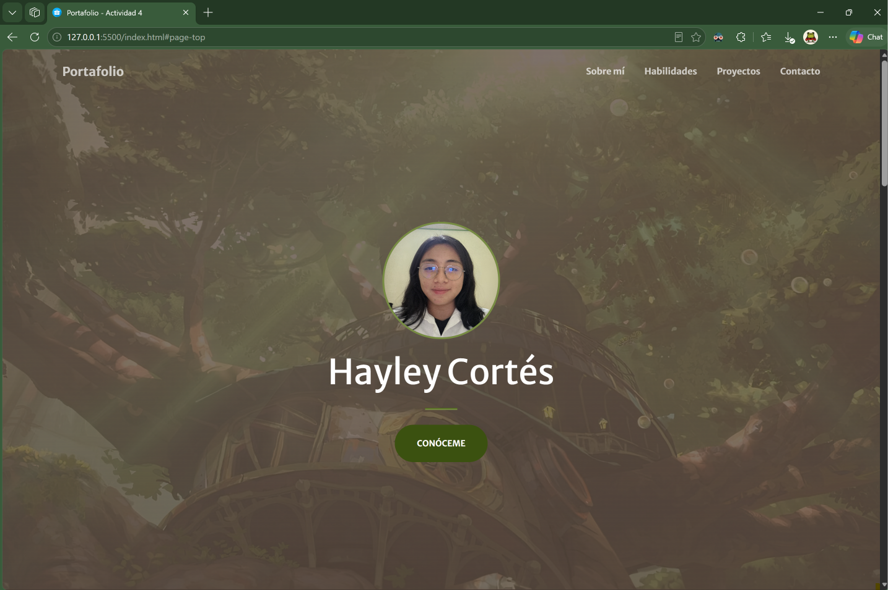
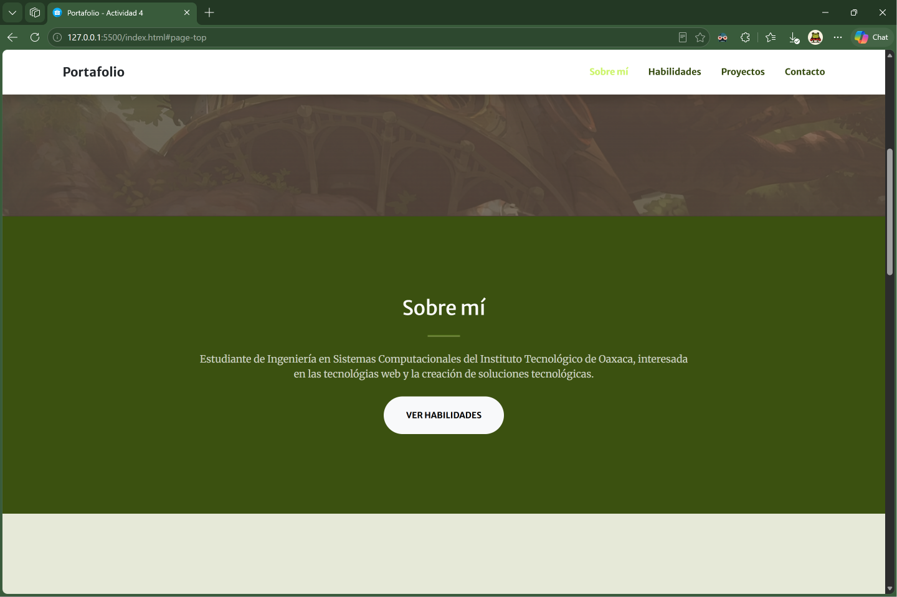
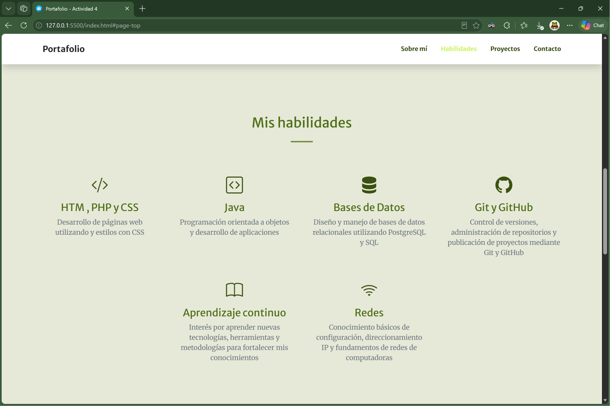
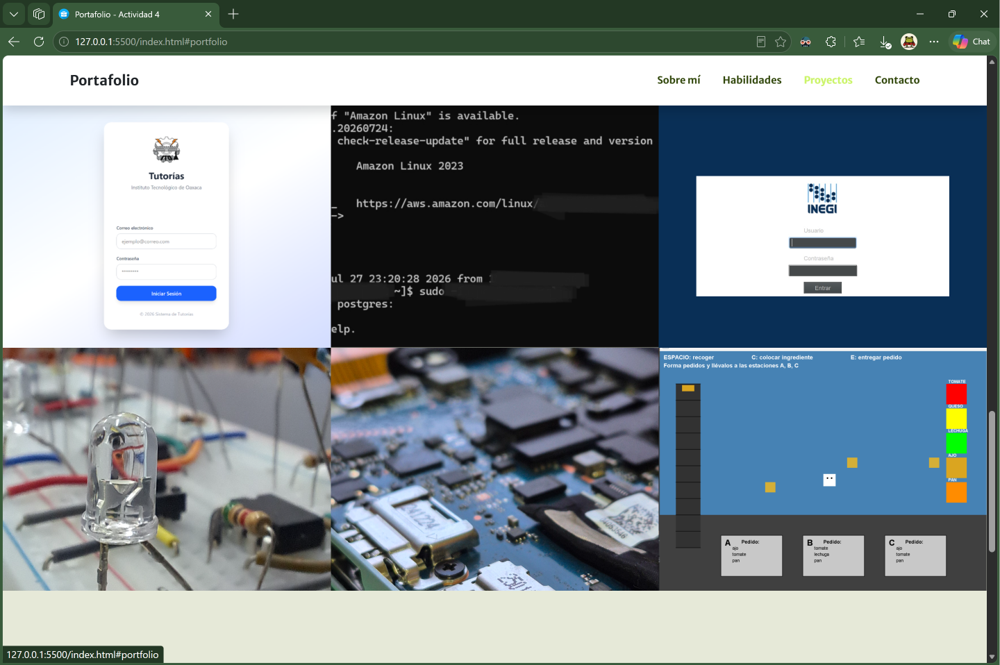
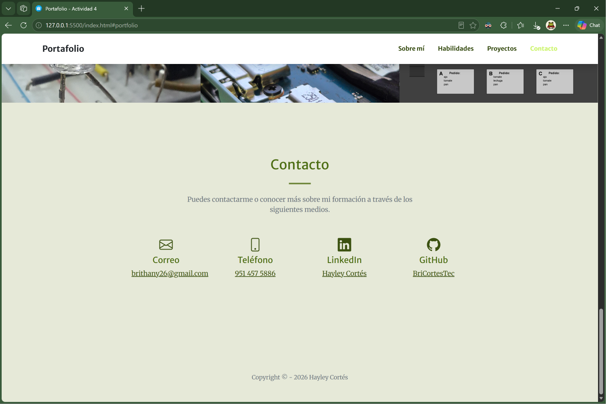

# Portafolio Personal — Actividad 4

## Portada

**Nombre del proyecto:** Portafolio Personal
**Autora:** Hayley Cortés
**Institución:** Instituto Tecnológico de Oaxaca
**Carrera:** Ingeniería en Sistemas Computacionales
**Materia:** Programación Web

### Descripción breve

Este proyecto consiste en el desarrollo de un portafolio web personal para presentar información académica, habilidades, proyectos realizados y medios de contacto.

El portafolio fue desarrollado utilizando HTML, CSS y JavaScript, tomando como base una plantilla prediseñada de Bootstrap y realizando modificaciones en su estructura, contenido, estilos y elementos visuales para adaptarla a un perfil académico y profesional.

---

# Descripción del proyecto

## Framework CSS utilizado

Para el desarrollo del portafolio se utilizó **Bootstrap 5**, un framework CSS que permite crear interfaces web responsivas mediante componentes y clases prediseñadas.

La plantilla utilizada fue:

**Creative - One Page Bootstrap Theme**

Plantilla desarrollada por **Start Bootstrap**.

Descarga de la plantilla: https://startbootstrap.com/theme/creative

La plantilla fue utilizada como base para la estructura visual del portafolio y posteriormente se modificó para adaptarla a las necesidades del proyecto.

## Estructura del portafolio

El portafolio está compuesto por las siguientes secciones:

### 1. Inicio

Es la sección principal que aparece al ingresar al sitio.

Contiene:

* Fotografía de perfil.
* Nombre completo.
* Botón "Conóceme".

La fotografía fue agregada para identificarme.

### 2. Sobre mí

Esta sección presenta una breve descripción sobre la formación que he obtenido hasta ahora.

Relato que estudio la carrera Ingeniería en Sistemas Computacionales del Instituto Tecnológico de Oaxaca y se mencionan mis intereses relacionados con el desarrollo web y la creación de soluciones tecnológicas.

También contiene un botón que permite desplazarse directamente hacia la sección de habilidades.

### 3. Habilidades

En esta sección se muestran diferentes conocimientos y áreas de interés relacionados de la formación académica.

Las habilidades incluidas son:

* HTML, PHP y CSS.
* Java.
* Bases de datos.
* Git y GitHub.
* Aprendizaje continuo.
* Redes.

Cada habilidad cuenta con un icono, un título y una breve descripción.

Además, se realizaron modificaciones de estilo para presentar las habilidades de una manera más organizada y visual.

### 4. Proyectos

La sección de proyectos presenta algunos de los trabajos realizados durante la formación académica.

Los proyectos incluidos son:

1. Sistema de administración de tutorados.
2. Administración de servidor PostgreSQL a través de SSH.
3. Base de datos sobre información del INEGI.
4. Temporizadores electrónicos.
5. Mantenimiento de hardware.
6. Recreación del juego Pressure Cooker.

Cada proyecto cuenta con una imagen representativa, una categoría y su nombre.

### 5. Contacto

Esta sección permite consultar diferentes medios para establecer contacto con la autora.

Se incluyen:

* Correo electrónico.
* Teléfono.
* LinkedIn.
* GitHub.

Los enlaces permiten acceder directamente a cada medio de contacto.

### 6. Pie de página

Al final del portafolio se encuentra un pie de página que contiene el año y el nombre de la autora.

---

# Proceso de creación

El portafolio se desarrolló a partir de una plantilla prediseñada de Bootstrap. El proceso realizado fue el siguiente:

### Paso 1. Selección de la plantilla

Primero se seleccionó la plantilla **Creative - One Page Bootstrap Theme** de Start Bootstrap debido a que cuenta con una estructura de una sola página adecuada para desarrollar un portafolio personal.

La plantilla se descargó desde:

https://startbootstrap.com/theme/creative

### Paso 2. Preparación del proyecto

Los archivos de la plantilla fueron incorporados al proyecto de la Actividad 4.

La estructura utilizada fue:

```text
actividad4/
├── index.html
├── README.md
├── css/
│   └── styles.css
├── js/
│   └── scripts.js
└── img/
```

Se conservaron los archivos principales de la plantilla y se organizaron las imágenes utilizadas por el portafolio dentro de la carpeta `img`.

### Paso 3. Modificación del HTML

Se modificó el archivo `index.html` para reemplazar el contenido original de la plantilla por información personal y académica.

Se cambiaron:

* Nombre del proyecto.
* Nombre de la autora.
* Textos de presentación.
* Menú de navegación.
* Sección "Sobre mí".
* Sección de habilidades.
* Sección de proyectos.
* Sección de contacto.

También se agregaron enlaces hacia medios de contacto.

### Paso 4. Personalización de la sección de inicio

Se agregó una fotografía de perfil propia en la parte superior del nombre.

La imagen se configuró mediante CSS para que tuviera una forma circular y un tamaño reducido, buscando que se integrara mejor con el diseño de la plantilla.

### Paso 5. Creación de la sección de habilidades

La sección de servicios original de la plantilla fue adaptada para representar habilidades académicas y técnicas.

Se agregaron diferentes conocimientos relacionados con:

* Desarrollo web.
* Programación.
* Bases de datos.
* Control de versiones.
* Redes.

También se utilizaron iconos de Bootstrap Icons para representar visualmente cada habilidad.

### Paso 6. Modificación de la sección de proyectos

La sección de portafolio original se modificó para mostrar proyectos académicos propios.

Se reemplazaron las imágenes y textos de ejemplo de la plantilla por imágenes y descripciones correspondientes a los proyectos realizados.

También se ajustó mediante CSS el tamaño de las imágenes para mantener una presentación uniforme.

### Paso 7. Personalización de colores y estilos

Se modificaron algunos estilos de Bootstrap para adaptar la apariencia del portafolio.

También se realizaron modificaciones en el tamaño de imágenes, tarjetas de habilidades, fotografía de perfil y otros elementos visuales.

### Paso 8. Creación de la sección de contacto

Se eliminó el formulario de contacto incluido originalmente en la plantilla, ya que requería configuración adicional de un servicio externo.

En su lugar, se creó una sección con diferentes medios de contacto:

* Correo electrónico.
* Teléfono.
* Instagram
* LinkedIn.
* GitHub.

De esta manera, los visitantes pueden acceder directamente a los medios de contacto disponibles.

### Paso 9. Pruebas en el navegador

Finalmente, el proyecto fue probado localmente en el navegador para comprobar:

* Funcionamiento de los enlaces del menú.
* Visualización de las imágenes.
* Funcionamiento de los botones.
* Distribución de las secciones.
* Diseño responsivo.
* Correcta carga de los archivos CSS y JavaScript.

Después de realizar las pruebas y correcciones, el proyecto puede publicarse mediante GitHub Pages.

---

# Capturas de pantalla

A continuación se muestran capturas del portafolio funcionando en el navegador.

## Inicio



En esta captura se muestra la sección principal del portafolio, incluyendo la fotografía de perfil, el nombre de la autora y el botón "Conóceme".

## Sobre mí



En esta sección se muestra la información académica y una breve descripción del perfil.

## Habilidades



Se muestran las diferentes habilidades y conocimientos incluidos en el portafolio.

## Proyectos



Se muestran los proyectos académicos realizados, acompañados de imágenes representativas.

## Contacto



Se muestran los diferentes medios de contacto y enlaces a redes profesionales.

---

# Tecnologías utilizadas

* HTML5
* CSS3
* JavaScript
* Bootstrap 5
* Bootstrap Icons
* Git
* GitHub
* GitHub Pages

---

# Autor

**Hayley Cortés**

Ingeniería en Sistemas Computacionales
Instituto Tecnológico de Oaxaca

GitHub: https://github.com/BriCortesTec
